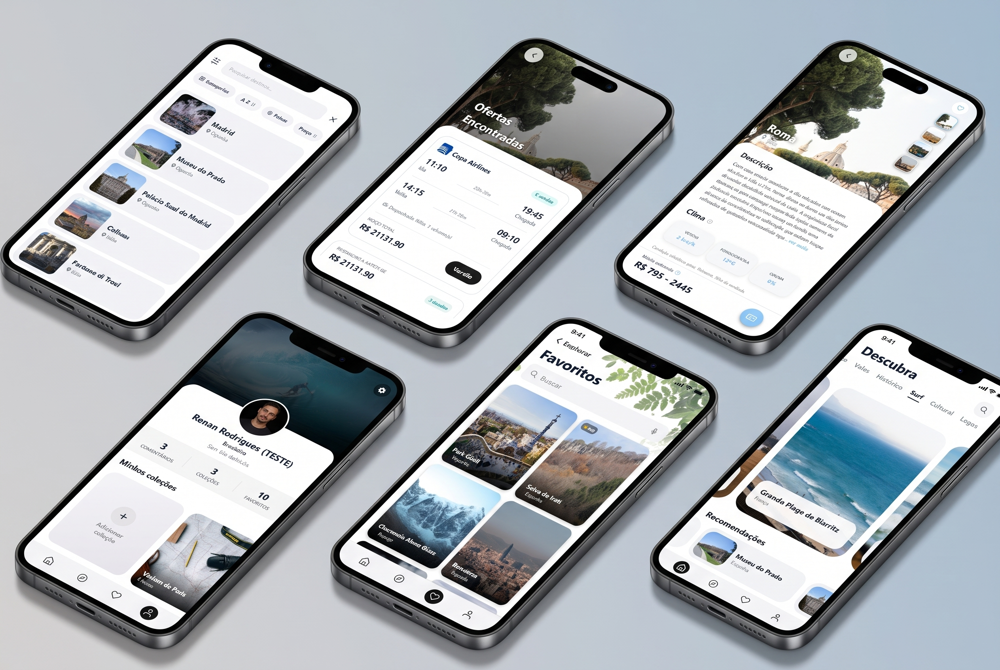

<div align="center">

# Travel App (Frontend)

<p align="center">
  Aplicativo mobile desenvolvido em <strong>React Native</strong> e <strong>Expo</strong> para exploração de destinos turísticos, cotação de passagens aéreas e planejamento inteligente de viagens.
</p>

[](#como-rodar-o-projeto)
[](https://reactnative.dev/)
[](https://expo.dev/)
[](LICENSE)

<br/>
<br/>



</div>

---

## Tecnologias

| Tecnologia | Finalidade |
| :--- | :--- |
| **React Native (0.86)** | Framework para construção de interfaces mobile nativas para Android e iOS a partir de uma base de código compartilhada. |
| **Expo (SDK 57)** | Plataforma com conjunto de ferramentas e APIs nativas para desenvolvimento, compilação e execução do aplicativo. |
| **@tanstack/react-query (v5)** | Gerenciamento de estado assíncrono, cache em memória, paginação infinita (*infinite scroll*) e deduplicação de requisições. |
| **React Navigation (v7)** | Sistema de navegação com suporte a pilhas nativas (*Native Stack*) e barra de abas inferior customizada (*Bottom Tabs*). |
| **@react-native-google-signin/google-signin** | Integração nativa de autenticação social com contas Google. |
| **@react-native-async-storage/async-storage** | Armazenamento chave-valor local assíncrono para persistência de tokens JWT e preferências do usuário. |
| **React Native Reanimated & Gesture Handler** | Criação de animações declarativas de alto desempenho e manipulação fluida de gestos na interface. |
| **Expo Image Manipulator & Image Picker** | Seleção de imagens da galeria e conversão automática no dispositivo para formato **WebP** com compressão antes do upload. |
| **Expo Linear Gradient & Expo Blur** | Aplicação de gradientes estilizados e efeitos de desfoque translúcido (*BlurView*) em cabeçalhos e barras de navegação. |
| **@expo/vector-icons** | Pacote de ícones vetoriais integrados (famílias Ionicons e Feather). |

---

## O que é esse projeto?

O **Travel App** é um aplicativo mobile completo voltado ao turismo e planejamento de viagens, projetado para oferecer uma experiência fluida na descoberta de novos destinos. Pelo app, o viajante tem acesso a um catálogo global de locais com fotos em alta definição, previsões meteorológicas ao vivo, resumos culturais e estimativas médias de custo geradas por inteligência artificial, mecanismo de busca e cotação de voos em tempo real com seleção de aeroportos IATA, espaço para publicação de avaliações comunitárias com fotos em formato polaroid e controle de favoritos e coleções pessoais sincronizadas com a nuvem.

---

## Motivação

O projeto foi criado com o objetivo de desenvolver um produto mobile de nível de produção, adotando as melhores práticas do ecossistema moderno do React Native. A motivação central esteve em resolver desafios reais de engenharia de software no ambiente mobile: implementar uma arquitetura modular escalável (*feature-based*), aplicar cache resiliente de dados com TanStack Query para evitar requisições redundantes, construir uma interface dinâmica com alternância de temas (claro/escuro) e esqueletos de carregamento (*shimmer skeletons*), e garantir a integração segura e transparente com uma API backend própria em Spring Boot — incluindo ciclo completo de rotação de refresh tokens e compressão de mídia antes do envio.

---

## Funcionalidades

### 1. Descoberta e Exploração
* **Feed inicial dinâmico:** carrosséis de destinos em destaque e lista de recomendações com paginação infinita (*infinite scroll*) via React Query.
* **Filtros por categorias:** navegação temática (florestas, praias, montanhas, desertos, cidades históricas) com transição de cores e gradientes contextuais.
* **Busca com debounce:** modal de pesquisa em tempo real com feedback imediato para busca por nome de cidade ou país.
* **Catálogo em grade:** tela de exploração em grade vertical com paginação e ordenação de destinos.

### 2. Detalhes do Destino
* **Galeria interativa:** visualizador de fotos em alta resolução em tela cheia com barra de navegação por miniaturas (*thumbnails*).
* **Previsão do tempo ao vivo:** exibição de temperatura, sensação térmica, probabilidade de chuva e velocidade do vento integrados ao backend.
* **Informações turísticas com IA:** resumos de viagem e estimativas de despesas médias categorizadas por destino.
* **Avaliações da comunidade:**
  * Avaliação por estrelas (1 a 5) com comentários de texto.
  * Anexo e visualização de fotos de viagens em estilo polaroid com ampliação.
  * Votação de comentários úteis pela comunidade.

### 3. Busca e Cotação de Passagens Aéreas
* **Pesquisa de aeroportos:** autocompletar com código IATA, cidade e país para origem e destino.
* **Filtros de voo:** seleção de passageiros (adultos e crianças), classe de cabine (econômica, econômica premium, executiva ou primeira classe) e tipo de ordenação (menor preço, menor tempo ou melhor custo-benefício).
* **Calendário integrado:** modal visual para definição de datas de ida e volta.
* **Listagem de bilhetes:** exibição de companhias aéreas, horários de partida/chegada, escalas, tempo total de voo e regras de bagagem.

### 4. Perfil, Coleções e Favoritos
* **Destinos favoritos:** salvamento e remoção rápida com atualização imediata de cache e suporte a *pull-to-refresh*.
* **Coleções pessoais de fotos:** criação e organização de álbuns de viagem dentro do perfil, permitindo upload múltiplo e visualização em grade.
* **Gerenciamento de conta:** edição do perfil com nome completo, biografia, país de origem (com seleção de bandeiras) e upload de foto de avatar.

### 5. Autenticação e Sessão
* **Cadastro e login local:** formulários com e-mail e senha.
* **Login social com Google:** autenticação nativa via Google Sign-In SDK.
* **Onboarding interativo:** telas de introdução (*Get Started* e *Welcome*) com persistência de exibição no dispositivo para novos usuários.

---

## Interface (UI/UX)

* **Tema Escuro e Tema Claro:** alternância completa de modos de cor gerenciada por contexto (`ThemeContext`), com suporte a persistência da preferência do usuário via `AsyncStorage`.
* **Paletas de cores contextuais:** adaptação visual automática da interface (cores de destaque, tons de cabeçalho e gradientes) em função da categoria de destino selecionada.
* **Efeito Shimmer / Skeletons:** conjunto completo de componentes de esqueleto (`Skeleton.js`) que reproduzem as dimensões exatas de cartões, listas, cabeçalhos e botões enquanto as requisições estão em andamento, eliminando saltos de layout (*layout shift*).
* **Transições e micro-interações:**
  * Animação com esmaecimento suave (*fade-in*) ao renderizar imagens remotas.
  * Transições verticais em modais transparentes (detalhes do destino e cotação de voos) para navegação sem piscamentos de tela.
  * Barra de navegação inferior flutuante com desfoque de fundo (`expo-blur`) e integração com o deslocamento de rolagem das telas.

---

## Segurança

* **Autenticação sem estado via JWT:** armazenamento local protegido dos tokens de acesso (`accessToken`) e atualização (`refreshToken`) através do `AsyncStorage`.
* **Renovação transparente de sessão:** interceptação global de requisições HTTP pelo `apiClient`; ao identificar um código de resposta `401 Unauthorized`, o cliente dispara silenciosamente a renovação de credenciais via endpoint `/api/auth/refresh`. Em caso de sucesso, refaz a requisição original de forma transparente para o usuário; caso o refresh token seja inválido ou tenha sido revogado, o aplicativo purga o armazenamento local (`multiRemove`) e força a reautenticação.
* **Autenticação segura com Google:** obtenção do `idToken` criptográfico emitido pelo Google Play Services e envio direto para validação e autorização no backend.
* **Sanitização de cabeçalhos de envio:** isolamento estrito de dados sensíveis e controle de formato nos cabeçalhos HTTP de autorização.

---

## Validações

* **Validação de formulários de autenticação:**
  * Verificação de preenchimento obrigatório para nome, e-mail e senha.
  * Validação de tamanho mínimo de senha (mínimo de 6 caracteres no cliente).
  * Checagem de correspondência exata entre senha e confirmação de senha antes do disparo de rede.
* **Padronização e conversão de fotos para WebP (`webpHelper.js`):**
  * O aplicativo intercepta seleções de imagem na galeria e as converte obrigatoriamente para o formato `image/webp` com compressão controlada (qualidade 0.85) utilizando a biblioteca `expo-image-manipulator` no ambiente nativo (iOS/Android) ou Canvas HTML5 no ambiente Web.
  * Essa conversão local garante o envio de arquivos leves e assegura conformidade com o formato estritamente aceito pelo serviço de armazenamento do backend.
* **Validação de busca de passagens:**
  * Bloqueio de submissão quando origem e destino forem idênticos.
  * Consistência cronológica nas datas de ida e volta do calendário.
* **Mapeamento de erros de negócio da API (`fieldErrors`):**
  * O cliente HTTP captura as mensagens de validação estruturadas retornadas pelo Spring Boot (`Jakarta Validation`) e exibe o aviso específico do campo inválido diretamente na tela correspondente.

---

## Tratamento de Erros

* **Componente centralizado de feedback (`StateFeedbackView`):**
  * Mecanismo visual reutilizável em todo o app para apresentar ilustrações, mensagens claras e botões de ação conforme o estado retornado pela rede.
* **Queda de conexão e falhas de rede:**
  * Detecção de falhas de conectividade (`TypeError: Network request failed` ou indisponibilidade do servidor) com exibição de tela dedicada e botão direto de tentar novamente (*retry*).
* **Recurso não encontrado (HTTP 404):**
  * Feedback visual orientando o usuário sobre a ausência do registro (ex.: voo esgotado ou destino indisponível) com ação para retornar ao início.
* **Falhas de servidor (HTTP 500):**
  * Tratamento amigável para indisponibilidades temporárias sem fechamento ou travamento do app.
* **Estados vazios (*Empty States*):**
  * Telas dedicadas e informativas para listas sem itens cadastrados (nenhum destino adicionado aos favoritos, nenhuma foto enviada nas coleções ou nenhum voo retornado nos filtros).

---

## Arquitetura

### Estrutura de pastas

A estrutura de código do frontend é modular e segue o padrão arquitetural orientado a funcionalidades (*package by feature*):

```text
travel-app-frontend/
├── assets/                    # Ícones de inicialização, splash e recursos estáticos
├── src/
│   ├── assets/                # Imagens ilustrativas, ícones temáticos e fundos
│   ├── config/                # Cliente HTTP centralizado (apiClient) e variáveis (env)
│   ├── context/               # Provedor global de autenticação (AuthContext)
│   ├── features/              # Módulos encapsulados por domínio de negócio
│   │   ├── auth/              # Telas, hooks, componentes e estilos de Login e Cadastro
│   │   ├── categories/        # Hooks de consulta e sincronização de categorias
│   │   ├── destinations/      # Detalhes do destino, galeria de fotos e avaliações
│   │   ├── explore/           # Tela de exploração e catálogo de destinos
│   │   ├── favorites/         # Gestão e listagem de destinos favoritados
│   │   ├── flights/           # Mecanismo de busca, modais e resultados de voos
│   │   ├── home/              # Tela inicial, recomendações e barra de busca
│   │   ├── onboarding/        # Telas de introdução (GetStarted e Welcome)
│   │   └── profile/           # Perfil do usuário, coleções de fotos e edição
│   ├── navigation/            # Navegadores Stack e Bottom Tab customizados
│   ├── shared/                # Componentes globais (Skeleton, StateFeedbackView), utils e tipos
│   └── theme/                 # Provedor de tema claro/escuro e paletas contextuais
├── App.js                     # Ponto de entrada com provedores (React Query, Tema, Auth)
├── app.json                   # Manifesto e configurações do ecossistema Expo
└── package.json               # Dependências e scripts de execução
```

### Rotas de navegação

A navegação do aplicativo é organizada entre a pilha raiz (`RootNavigator`) e o navegador em abas inferiores (`AppNavigator`):

| Navegador | Rota | Componente / Tela | Descrição / Acesso |
| :--- | :--- | :--- | :--- |
| **Pilha Raiz** | `GetStarted` | `GetStartedScreen` | Tela de apresentação inicial para novos usuários não autenticados. |
| **Pilha Raiz** | `Login` | `LoginScreen` | Tela de autenticação com e-mail/senha ou Google. |
| **Pilha Raiz** | `Register` | `RegisterScreen` | Tela de cadastro de novas contas no sistema. |
| **Pilha Raiz** | `Welcome` | `WelcomeScreen` | Boas-vindas exibida na primeira autenticação com sucesso. |
| **Pilha Raiz** | `Main` | `AppNavigator` | Contêiner principal com a navegação em abas inferiores (sessão ativa). |
| **Pilha Raiz** | `Details` | `DetailsScreen` | Modal transparente com visão completa do destino, clima, fotos e avaliações. |
| **Pilha Raiz** | `DetailsTicket` | `FlightSearchScreen` | Modal transparente para busca, filtros e cotação de passagens aéreas. |
| **Pilha Raiz** | `CollectionGallery`| `CollectionGalleryScreen` | Visualizador em grade e tela cheia de fotos das coleções pessoais. |
| **Abas Inferiores**| `Home` | `HomeScreen` | Feed principal com destaques, categorias e recomendações turísticas. |
| **Abas Inferiores**| `Explore` | `ExploreScreen` | Catálogo em grade para busca e navegação entre destinos. |
| **Abas Inferiores**| `Favorites` | `FavoritesScreen` | Listagem em tempo real de destinos salvos pelo usuário. |
| **Abas Inferiores**| `Profile` | `ProfileScreen` | Perfil do usuário, coleções fotográficas e configurações de conta. |

### Integração com APIs

A camada de rede é centralizada no módulo `src/config/apiClient.js`:

* **Comunicação unificada:** abstração sobre requisições com montagem automática de URLs e cabeçalhos.
* **Upload multipart nativo:** suporte a envio de formulários multipartes (`FormData`) via `XMLHttpRequest` nativo no ambiente mobile para monitoramento e integridade no envio de arquivos pesados (fotos de perfil e coleções).
* **Interceptors e renovação de token:** injeção automática de `Authorization: Bearer <accessToken>` e interceptor de erro HTTP 401 para renovação atômica via refresh token.
* **Endpoints consumidos:**
  * `/api/auth` — Registro, autenticação local, login social com Google e renovação de token.
  * `/api/destinations` — Catálogo, detalhes, previsão de tempo e estimativas de custo via IA.
  * `/api/categories` — Lista de categorias temáticas e esquemas de cores.
  * `/api/flights` e `/api/airports` — Consulta de aeroportos IATA e cotação de bilhetes aéreos.
  * `/api/favorites` — Adição, remoção e listagem de destinos salvos.
  * `/api/comments` — Cadastro de avaliações, envio de fotos e contagem de votos úteis.
  * `/api/collections` — Álbuns pessoais de fotos de viagem.
  * `/api/users` — Consulta e atualização cadastral do viajante e foto de avatar.

### Gerenciamento de estado

* **Estado de servidor e cache (@tanstack/react-query):**
  * Gerencia o ciclo de vida de dados assíncronos, tempo de expiração (*staleTime* e *cacheTime*) e sincronização em segundo plano.
  * Utilização de `useInfiniteQuery` para paginação contínua e deduplicação de itens nas listagens de destinos.
  * Invalidação seletiva de chaves de query (ex: atualizar lista de favoritos ou comentários instantaneamente após uma mutação).
* **Estado global de aplicação (React Context API):**
  * `AuthContext`: gerencia a sessão ativa, dados do perfil do usuário autenticado, fluxo de login, cadastro, login com Google e logout seguro.
  * `ThemeContext`: controla a alternância entre tema claro e tema escuro, fornecendo paletas dinâmicas para toda a árvore de componentes.

---

## Configuração do Ambiente

Crie um arquivo `.env` na raiz do projeto com base no arquivo [.env.example](.env.example):

| Variável | Descrição | Exemplo |
| :--- | :--- | :--- |
| `EXPO_PUBLIC_API_URL` | Endereço base da API REST backend em Spring Boot | `http://192.168.1.50:8080/api` |
| `EXPO_PUBLIC_PEXELS_API_KEY` | Chave de autenticação da API Pexels para imagens | `563492ad6f91700001000001...` |
| `EXPO_PUBLIC_WEATHER_API_KEY` | Chave de integração meteorológica externa | `sua_chave_weather_api` |
| `EXPO_PUBLIC_GEMINI_API_KEY` | Chave de API do Google Gemini para insights e resumos | `AIzaSyD...` |
| `EXPO_PUBLIC_RAPIDAPI_KEY` | Chave da RapidAPI para cotação e consulta de voos | `9a8b7c6d5e...` |

> **Atenção:** Ao executar o aplicativo em um smartphone físico através do Expo Go, utilize o endereço IP local da sua máquina (ex: `http://192.168.x.x:8080/api`) no lugar de `localhost`.

---

## Testes

> [!NOTE]
> A suíte automatizada de testes do frontend está atualmente em fase de **planejamento e estruturação**.

### Escopo e ferramentas planejadas:
* **Testes unitários e de integração:** [Jest](https://jestjs.io/) e [React Native Testing Library](https://callstack.github.io/react-native-testing-library/).
* **Cenários previstos:**
  - [ ] Validações de entrada nos hooks de formulário de autenticação (`useLoginForm`, `useRegisterForm`).
  - [ ] Conversão e compressão de imagens para o formato WebP no helper de mídia (`webpHelper`).
  - [ ] Comportamento visual e renderização do componente de estados e erros (`StateFeedbackView`).
  - [ ] Fluxos de navegação e proteção de rotas privadas na pilha raiz.

---

## Como Rodar o Projeto

### Pré-requisitos
* [Node.js](https://nodejs.org/) (versão LTS recomendada: 18 ou superior)
* Gerenciador de pacotes `npm` ou `yarn`
* Aplicativo **Expo Go** instalado no celular ([Android](https://play.google.com/store/apps/details?id=host.exp.exponent) / [iOS](https://apps.apple.com/app/expo-go/id982107779)) ou um emulador/simulador configurado (Android Studio ou Xcode)
* Servidor do [travel-app-backend](https://github.com/devrnrodrigues/travel-app-backend) em execução

### 1. Clonar o repositório
```bash
git clone https://github.com/devrnrodrigues/travel-app-frontend.git
cd travel-app-frontend
```

### 2. Instalar as dependências
```bash
npm install
```

### 3. Configurar as variáveis de ambiente
Copie o template de variáveis e defina a URL da sua API local:
```bash
cp .env.example .env
```

### 4. Iniciar o servidor de desenvolvimento Expo
```bash
npx expo start
```

### 5. Executar no dispositivo ou emulador
* **Dispositivo físico:** abra o aplicativo **Expo Go** e aponte a câmera para o QR Code exibido no terminal.
* **Android:** pressione a tecla `a` no terminal (ou execute `npx expo start --android`).
* **iOS (macOS):** pressione a tecla `i` no terminal (ou execute `npx expo start --ios`).
* **Web:** pressione a tecla `w` no terminal (ou execute `npx expo start --web`).

---

## Licença

Este projeto está distribuído sob os termos da licença **MIT**. Para mais detalhes, consulte o arquivo [LICENSE](LICENSE).
